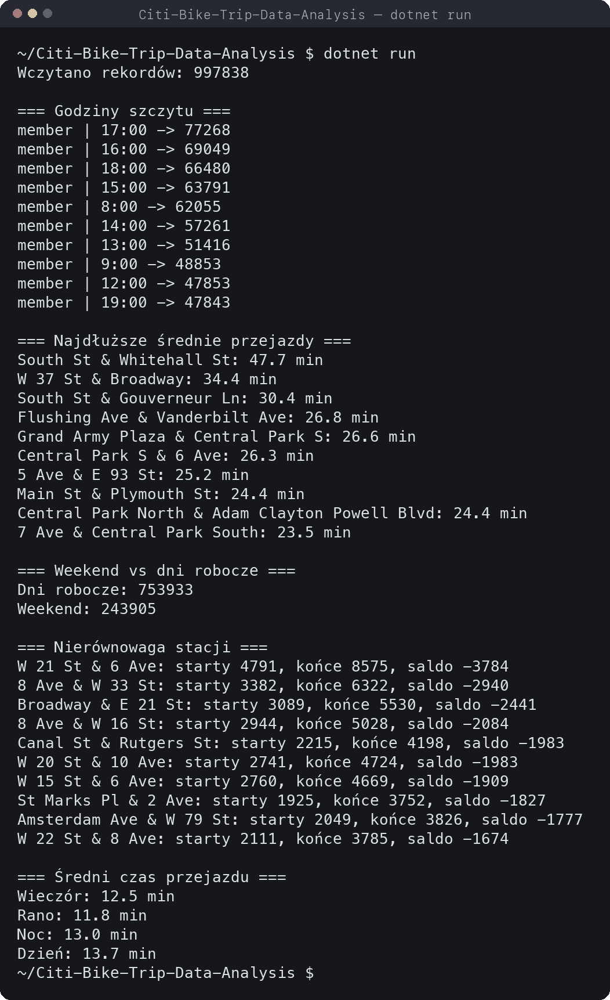
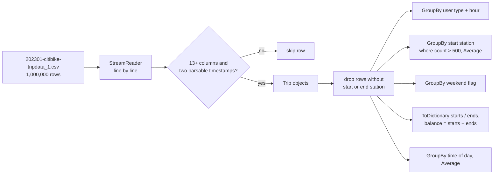

# Citi Bike Trip Data Analysis

A C# console program that loads one million NYC Citi Bike trips from January 2023, drops
malformed rows, and answers five usage questions with LINQ: peak hours per rider type, stations
with the longest average rides, weekday versus weekend volume, stations that drain or
accumulate bikes, and average ride length by time of day. The whole run, including parsing a
195 MB CSV, takes about two seconds on an Apple M3.

Written as an academic exercise in file parsing, data validation and collection processing.

## Preview

Real output of `dotnet run` on this repository's dataset (recorded in a terminal; labels are in
Polish because the course was taught in Polish).


<details>
<summary>Full output as a still image</summary>



</details>

## Results on the January 2023 dataset

Of the 1,000,000 rows, 997,838 survive validation (the rest lack a parsable timestamp or a
station name).

| Question | Finding |
| --- | --- |
| Peak hours by rider type | All ten busiest hour slots belong to members. The top slot is 17:00 with 77,268 trips, followed by 16:00 and 18:00. The morning peak at 08:00 ranks fifth. |
| Longest average ride (stations with more than 500 departures) | South St & Whitehall St leads at 47.7 minutes, well ahead of W 37 St & Broadway at 34.4. Several Central Park stations fill the rest of the list. |
| Weekdays versus weekend | 753,933 weekday trips against 243,905 weekend trips, a 3.1 to 1 ratio for a 22 to 9 day split. |
| Station imbalance | W 21 St & 6 Ave ends 3,784 more trips than it starts. All ten most imbalanced stations are net receivers in Manhattan, which points to where bikes have to be trucked away. |
| Average ride length by time of day | Daytime rides are longest at 13.7 minutes, mornings shortest at 11.8. |

## How it works



- **Parsing.** `LoadTrips` reads the file with `StreamReader`, splits on commas and keeps only
  the five columns the analysis needs (`started_at`, `ended_at`, both station names,
  `member_casual`). Timestamps are parsed with `DateTime.TryParse` and the invariant culture;
  rows that fail are skipped rather than aborting the run.
- **Memory.** All valid trips are materialised as a `List<Trip>` (roughly one million small
  objects) so that five independent queries can run over the same data without re-reading the
  file.
- **Queries.** Each question is a single LINQ pipeline (`GroupBy`, `Where`, `Select`,
  `OrderByDescending`, `Take`, `Average`). The imbalance query builds two dictionaries keyed by
  station so that departures and arrivals can be joined in O(1) per station.
- **Time-of-day buckets.** Night 00–05, morning 06–11, day 12–17, evening 18–23, derived from
  the start hour.

### Data model

```csharp
public class Trip
{
    public DateTime StartedAt { get; set; }
    public DateTime EndedAt { get; set; }
    public string StartStation { get; set; }
    public string EndStation { get; set; }
    public string UserType { get; set; }   // "member" or "casual"
}
```

## Dataset

`202301-citibike-tripdata_1.csv` is the first file of the January 2023 export from
[Citi Bike System Data](https://citibikenyc.com/system-data), 1,000,000 trips plus a header,
about 195 MB. It is stored in this repository through Git LFS. Columns used: `started_at`,
`ended_at`, `start_station_name`, `end_station_name`, `member_casual`.

## Getting started

### Prerequisites

- [.NET SDK 9.0](https://dotnet.microsoft.com/download/dotnet/9.0) or newer
- [Git LFS](https://git-lfs.com/) to download the dataset

### Run

```bash
git lfs install
git clone https://github.com/anniigr/Citi-Bike-Trip-Data-Analysis.git
cd Citi-Bike-Trip-Data-Analysis
git lfs pull
dotnet run
```

The program reads the CSV from the current directory, so run it from the repository root. If
Git LFS was not installed before cloning, the CSV is a small pointer file; `git lfs pull`
replaces it with the real data.

## Project structure

```
Citi-Bike-Trip-Data-Analysis/
├── Program.cs                        # loading, validation, the five LINQ queries, console output
├── Trip.cs                           # trip record
├── CitiBikeAnalysis.csproj           # .NET 9 console project
├── 202301-citibike-tripdata_1.csv    # dataset (Git LFS)
├── .gitattributes                    # LFS rule for *.csv
└── docs/screenshots/                 # recording and still used above
```

## Limitations

- **Naive CSV splitting.** Rows are split on commas without quote handling. Station names in
  this export do not contain commas, so the result is correct for this dataset, but a general
  CSV parser would be needed for others.
- **Single file, single month.** The path is hard-coded and only the first of the January 2023
  files is analysed.
- **Everything in memory.** One million trips fit comfortably, but the approach would not scale
  to a full year without streaming aggregation.
- **No tests.** The queries are verified by inspecting the output shown above.
- **Output labels are in Polish.** Section headers and group names (`Noc`, `Rano`, `Dzień`,
  `Wieczór`, `Dni robocze`) are printed in Polish; the table in this README translates them.
